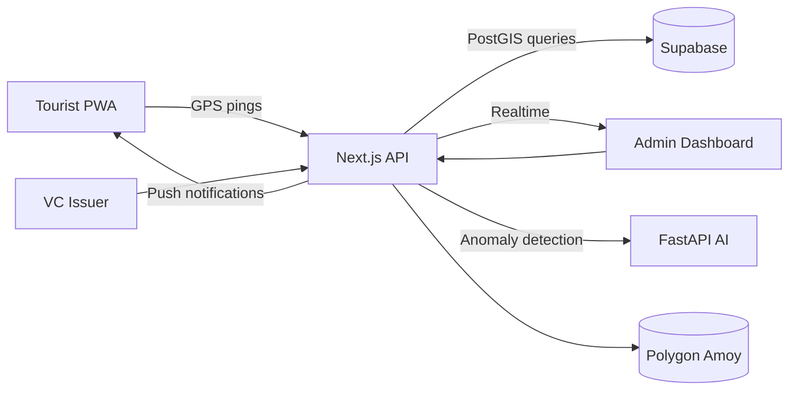

# TourSafe - Smart Tourist Safety & Incident Response

> **AI-powered tourist safety system with blockchain-verified credentials**

A comprehensive MVP solution for SIH 2025 PS-25002, delivering end-to-end tourist safety monitoring with real-time GPS tracking, AI anomaly detection, geofencing alerts, and blockchain audit trails.

## 🚀 Quick Start

```bash
# Install dependencies
pnpm install

# Set up environment (copy and fill in your keys)
cp .env.template .env.local

# Start development servers
make dev

# Seed database with demo data
make seed

# Run tourist simulation
make simulate
```

## 🏗️ Architecture Overview



## 🎯 Key Features

### Tourist Safety App (PWA)
- **📱 Progressive Web App** - Installable, works offline
- **🔐 Verifiable Credentials** - Blockchain-anchored identity
- **📍 GPS Tracking** - Real-time location with privacy controls
- **🆘 SOS Button** - One-tap emergency alerts
- **🗺️ Interactive Map** - Live zones and safety information
- **🔔 Push Notifications** - Geofence warnings and alerts
- **🌐 Multilingual** - English, Hindi, Tamil support

### Admin/Operator Dashboard
- **📊 Real-time Monitoring** - Live tourist locations and incidents
- **⚡ Incident Management** - Triage, assign, and resolve alerts
- **🗺️ Zone Management** - Create and edit geofenced areas
- **🔍 AI Analytics** - Anomaly detection and pattern analysis
- **🔗 Blockchain Audit** - Verify credentials and incident integrity
- **📈 Reporting** - Export data and incident reports

### Police & Tourism Department Dashboard
- **🚔 Real-time Visualizations** - Comprehensive monitoring with live updates
- **👥 Tourist Clusters** - Grid-based clustering with density analysis
- **🗺️ Risk Heat Maps** - Geographic visualization of high-risk zones
- **🔍 Digital ID Records** - Advanced search, filtering, and tracking
- **📍 Last Known Locations** - Real-time location tracking for all tourists
- **📋 Alert History** - Complete incident log with full details
- **⚡ Automated E-FIR** - One-click E-FIR generation for missing persons
- **📊 Analytics Dashboard** - Statistics, trends, and insights
- **📤 Data Export** - Export complete dashboard data for reports

### AI Anomaly Detection
- **🤖 Machine Learning** - IsolationForest for movement analysis
- **📊 Rule-based Detection** - Immobility and deviation patterns
- **⚡ Real-time Processing** - Sub-30-second analysis
- **🎯 Configurable Alerts** - Tunable sensitivity and thresholds

### Blockchain Integration
- **🔗 Polygon Amoy Testnet** - Cost-effective proof anchoring
- **📄 W3C VCs** - Standards-compliant credentials
- **🔒 Tamper-proof** - Cryptographic integrity verification
- **⚡ Fast Settlement** - 2-second block times

## 🛠️ Tech Stack

### Frontend & API
- **Next.js 14** - App Router, Server Components, API Routes
- **TypeScript** - Full type safety across the stack
- **Tailwind + shadcn/ui** - Modern, accessible UI components
- **MapLibre GL** - Interactive maps with OSM tiles
- **React Query** - Data fetching and state management

### Backend & Database  
- **Supabase** - PostgreSQL with PostGIS, Auth, Realtime
- **PostGIS** - Geospatial queries and indexing
- **Row Level Security** - Fine-grained access control
- **Real-time Subscriptions** - Live dashboard updates

### AI & ML
- **Python FastAPI** - High-performance AI microservice
- **scikit-learn** - Anomaly detection algorithms
- **NumPy/Pandas** - Data processing and analysis
- **Docker** - Containerized deployment

### Blockchain & Identity
- **ethers.js** - Ethereum/Polygon interaction
- **JOSE** - JWT signing and verification
- **Polygon Amoy** - L2 testnet for cost efficiency

### DevOps & Deployment
- **Vercel** - Frontend and API hosting
- **Render** - AI service deployment
- **GitHub Actions** - CI/CD pipeline
- **pnpm** - Fast, efficient package management

## 📁 Project Structure

```
toursafe-monorepo/
├── apps/
│   ├── web/                 # Next.js PWA + Dashboard
│   ├── api/                 # Next.js API Routes (part of web)
│   └── ai/                  # Python FastAPI Microservice
├── packages/
│   ├── ui/                  # Shared React components
│   ├── lib/                 # Shared TypeScript utilities
│   └── config/              # Shared configurations
├── scripts/                 # Seeding and simulation tools
├── supabase/               # Database migrations and config
├── docs/                   # Documentation
└── README.md
```

## 🚦 Getting Started

### Prerequisites
- Node.js 18+ and pnpm 8+
- Python 3.11+ (for AI service)
- Supabase account
- MapTiler account (free tier)
- Polygon wallet with test MATIC

### Environment Setup

1. **Copy environment template:**
   ```bash
   cp .env.template .env.local
   ```

2. **Fill in required keys:**
   ```env
   # Supabase (create project at supabase.com)
   NEXT_PUBLIC_SUPABASE_URL=https://xxx.supabase.co
   NEXT_PUBLIC_SUPABASE_ANON_KEY=xxx
   SUPABASE_SERVICE_ROLE_KEY=xxx

   # MapTiler (free tier at maptiler.com)
   NEXT_PUBLIC_MAPTILER_KEY=xxx

   # Polygon Amoy (get test MATIC from faucet)
   AMOY_RPC_URL=https://rpc-amoy.polygon.technology
   CHAIN_PRIVATE_KEY=0x...

   # App config
   NEXT_PUBLIC_APP_NAME=TourSafe
   ```

3. **Set up Supabase:**
   ```bash
   # Install Supabase CLI
   npm i -g supabase

   # Initialize and run migrations
   cd supabase
   supabase init
   supabase db reset
   ```

### Development

```bash
# Install all dependencies
pnpm install

# Start all services in development mode
make dev
# This runs:
# - Next.js web app on :3000
# - Python AI service on :8000
# - Supabase local instance on :54321

# In separate terminals:
make seed      # Populate demo data
make simulate  # Run tourist movement simulation
```

### Testing

```bash
# Run all tests
make test

# Test specific services
pnpm --filter web test        # Frontend tests
pnpm --filter ai test         # Python tests
pnpm run test-vc              # VC functionality
pnpm run test-chain           # Blockchain integration
```

## 🔧 Configuration

### Free Tier Limits & Setup

| Service | Free Tier | Setup Guide |
|---------|-----------|-------------|
| **Vercel** | 100GB bandwidth | [Deploy Guide](docs/DEPLOY.md#vercel) |
| **Supabase** | 500MB DB, 2GB bandwidth | [DB Setup](docs/FREE_TIER_SETUP.md#supabase) |
| **Render** | 750 hours/month | [AI Service](docs/DEPLOY.md#render) |
| **MapTiler** | 100k requests/month | [Maps Setup](docs/FREE_TIER_SETUP.md#maptiler) |
| **Polygon** | Testnet (free) | [Faucet Guide](docs/FREE_TIER_SETUP.md#polygon) |

### Security Configuration

- **HTTPS Only** - All endpoints use TLS
- **CORS** - Configured for production domains
- **Rate Limiting** - API endpoints protected
- **Input Validation** - Zod schemas on all inputs
- **SQL Injection** - Parameterized queries only
- **RLS Policies** - Database-level access control

## 📋 API Documentation

### Core Endpoints

```http
# VC Management
POST /api/v1/vc/issue        # Issue new credential
POST /api/v1/vc/verify       # Verify credential

# Location & Safety
POST /api/v1/ping            # Submit GPS location
GET  /api/v1/zones           # Get safety zones
POST /api/v1/zones           # Create safety zone

# Incident Management  
GET  /api/v1/incidents       # List incidents
POST /api/v1/incidents       # Create incident (SOS)
PATCH /api/v1/incidents/:id  # Update incident status

# E-FIR System
POST /api/v1/efir            # Generate E-FIR
GET  /api/v1/efir            # Get E-FIRs by tourist
PATCH /api/v1/efir           # Update E-FIR status

# Police Dashboard
GET  /api/v1/analytics       # Dashboard analytics
GET  /api/v1/heatmap         # Risk heat map data
GET  /api/v1/clusters        # Tourist clusters

# AI Analysis
POST /ai/score               # Analyze GPS patterns
```

See [API.md](docs/API.md) for detailed API documentation.

For Police Dashboard documentation, see:
- [POLICE_DASHBOARD.md](docs/POLICE_DASHBOARD.md) - Complete feature documentation
- [POLICE_DASHBOARD_QUICK_REFERENCE.md](docs/POLICE_DASHBOARD_QUICK_REFERENCE.md) - Quick reference guide

## 🎭 Demo Scenarios

### Scenario 1: Normal Tourism
1. Tourist imports VC → ✅ Verified on blockchain
2. Walks through safe zones → ✅ No alerts
3. AI detects normal movement → ✅ No incidents

### Scenario 2: Restricted Area Alert
1. Tourist approaches naval area → ⚠️ Geofence warning
2. Crosses boundary → 🚨 Incident auto-created
3. Operator receives notification → 🔔 Dashboard alert

### Scenario 3: Immobility Detection
1. Tourist stops moving for 6+ minutes → 🤖 AI detection
2. Incident auto-created → 📞 Emergency protocol
3. Operator acknowledges → ✅ Response initiated

### Scenario 4: SOS Emergency
1. Tourist taps SOS button → 🆘 Manual alert
2. GPS location captured → 📍 Precise coordinates
3. Push notification sent → ⚡ Real-time response

## 🚀 Deployment

### Production Deployment

1. **Deploy AI Service to Render:**
   ```bash
   # Connect GitHub repo to Render
   # Use Dockerfile in apps/ai/
   # Set environment variables
   ```

2. **Deploy Web App to Vercel:**
   ```bash
   vercel --prod
   # Automatic deployment from main branch
   ```

3. **Configure Production Database:**
   ```bash
   # Run migrations on production Supabase
   supabase db push
   ```

See [DEPLOY.md](docs/DEPLOY.md) for detailed deployment instructions.

## 📊 Monitoring & Analytics

- **Supabase Dashboard** - Database metrics and logs
- **Vercel Analytics** - Performance and usage stats
- **Custom Logging** - Structured JSON logs
- **Error Tracking** - Real-time error alerts
- **Performance Monitoring** - API response times

## 🤝 Contributing

This is a hackathon MVP, but contributions are welcome!

1. Fork the repository
2. Create feature branch (`git checkout -b feature/amazing-feature`)
3. Commit changes (`git commit -m 'Add amazing feature'`)
4. Push to branch (`git push origin feature/amazing-feature`)
5. Open a Pull Request

## 📄 License

This project is licensed under the MIT License - see the [LICENSE](LICENSE) file for details.

## 🎖️ Hackathon Submission

- **Event:** Smart India Hackathon 2025
- **Problem Statement:** PS-25002 - Smart Tourist Safety & Incident Response
- **Team:** [Your Team Name]
- **Demo:** [Live Demo URL]
- **Video:** [Demo Video URL]

## 📞 Support

- **Documentation:** [docs/](docs/)
- **Issues:** [GitHub Issues](https://github.com/your-repo/issues)
- **Email:** [your-email@example.com]

---

**Built with ❤️ for SIH 2025 | Ensuring safer travels through technology**